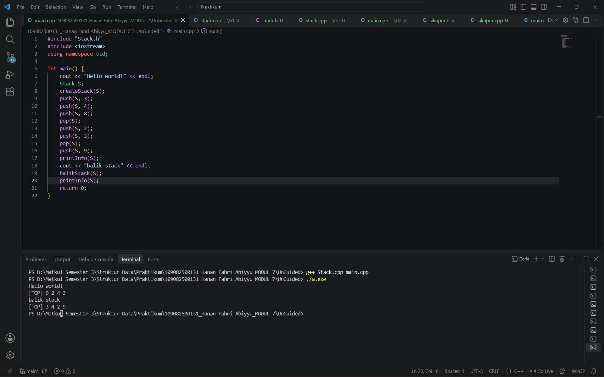
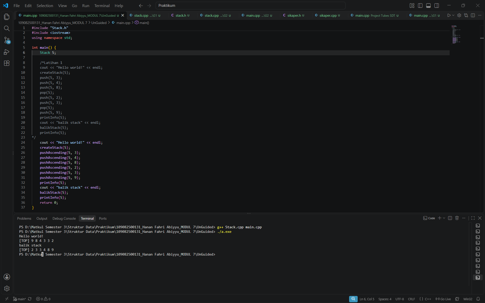
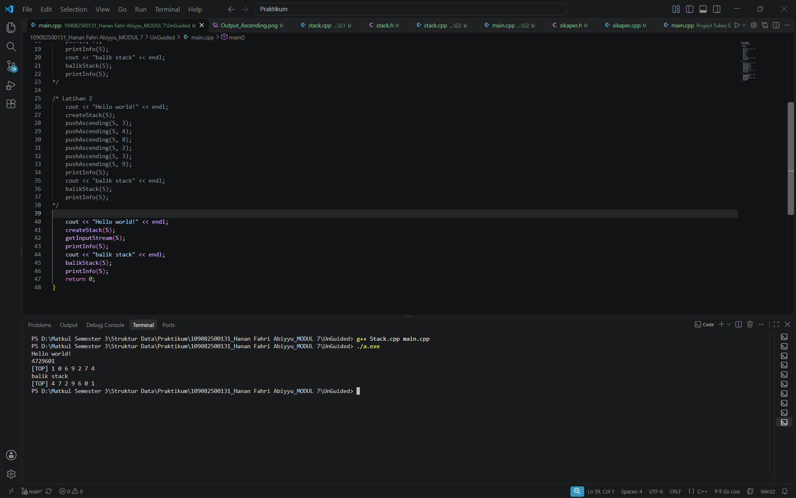

# <h1 align="center">Laporan Praktikum Modul 7 - STACK </h1>

<p align="center">Hanan Fahri Abiyyu - 109082500131</p>

## Dasar Teori

### A. Stack <br/>

Stack merupakan salah satu bentuk struktur data linier yang mengikuti aturan tertentu untuk melakukan operasi. Stack bersifat LIFO (Last In First Out) dan objek yang terakhir masuk ke dalam Stack akan menjadi yang pertama dikeluarkan [2].

#### Operasi Utama Stack
<br>
1. Push: menambahkan elemen baru ke dalam Stack pada posisi paling atas.
2. Pop: menghapus elemen teratas dari Stack dan mengembalikan nilainya.
3. Top: mengecek elemen teratas dari Stack tanpa menghapusnya.
4. IsEmpty: memeriksa apakah Stack kosong atau tidak.
5. Size: mengembalikan jumlah elemen dalam Stack. 

#### Kegunaan implementasi Stack 
Mengorganisasi data dan memudahkan penyimpanan komputer, digunakan dalam berbagai algoritma, seperti tower of hanoi, tree traversal, dan rekursi [2]. 

## Guided

### 1. Guided 

#### stack.h (Array)
```C++
#ifndef STACK_TABLE
#define STACK_TABLE
#include <iostream>
using namespace std;
const int MAX = 10;

struct stackTable {
    int data[MAX];
    int top;
};

bool isEmpty(stackTable s);
bool isFull(stackTable s);
void createStack(stackTable &s);
void push(stackTable &s, int angka);
void pop(stackTable &s);
void update(stackTable &s, int posisi);
void view(stackTable s);
void searchData(stackTable s, int data);
#endif
```

#### stack.cpp (Array)
```C++
#include "stack.h"
#include <iostream>
using namespace std;

bool isEmpty(stackTable s)
{
    return s.top == -1;
}
bool isFull(stackTable s)
{
    return s.top == MAX - 1;
}
void createStack(stackTable &s)
{
    s.top = -1;
}
void push(stackTable &s, int angka)
{

    if (isFull(s))
    {
        cout << "Stack penuh!" << endl;
    }
    else
    {
        s.top++;
        s.data[s.top] = angka;
        cout << "Data " << angka << " berhasil ditambahkan kedalam stack !" << endl;
    }
}

void pop(stackTable &s)
{
    if (isEmpty(s))
    {
        cout << "Stack kosong!" << endl;
    }
    else
    {
        int val = s.data[s.top];
        s.top--;
        cout << "Data " << val << " berhasil dihapus dari stack!" << endl;
    }
}

void update(stackTable &s, int posisi)
{
    if (isEmpty(s))
    {
        cout << "Stack kosong!" << endl;
    }
    if (posisi <= 0)
    {
        cout << "Posisi tidak valid!" << endl;
        return;
    }
    // index = top

    int idx = s.top - (posisi - 1);
    if (idx < 0 || idx > s.top)
    {
        cout << "Posisi " << posisi << " tidak valid!" << endl;
        return;
    }

    cout << "Update data posisi ke-" << posisi << endl;
    cout << "Masukkan angka : ";
    cin >> s.data[idx];
    cout << "Data berhasil diupdate!" << endl;
    cout << endl;
}

void view(stackTable s)
{
    if (isEmpty(s))
    {
        cout << "Stack kosong!" << endl;
    }
    else
    {
        for (int i = s.top; i >= 0; --i)
        {
            cout << s.data[i] << " ";
        }
    }
    cout << endl;
}

void searchData(stackTable s, int data)
{
    if (isEmpty(s))
    {
        cout << "Stack kosong!" << endl;
        return;
    }

    cout << "Mencari data " << data << "..." << endl;
    int posisi = 1;
    bool found = false;

    for (int i = s.top; i >= 0; --i)
    {
        if (s.data[i] == data)
        {
            cout << "Data " << data << " ditemukan pada posisi ke-" << posisi << endl;
            cout << endl;
            found = true;
            break;
        }
        posisi++;
    }

    if (!found)
    {
        cout << "Data " << data << " tidak ditemukan didalam stack!" << endl;
        cout << endl;
    }
}
```

#### main.cpp
```C++
#include "stack.h"
#include <iostream>

using namespace std;

int main()
{
    stackTable s;
    createStack(s);

    push(s, 1);
    push(s, 2);
    push(s, 3);
    push(s, 4);
    push(s, 5);
    cout << endl;

    cout << "--- Stack setelah push ---" << endl;
    view(s);
    cout << endl;

    pop(s);
    pop(s);
    cout << endl;

    cout << "--- Stack setelah pop 2 kali ---" << endl;
    view(s);
    cout << endl;

    update(s, 2);
    update(s, 1);
    cout << endl;

    cout << "--- Stack setelah update ---" << endl;
    view(s);
    cout << endl;

    searchData(s, 4);
    searchData(s, 9);

    return 0;
}
```

Program ini mengimplementasikan struktur data Stack (tumpukan) menggunakan representasi array atau tabel secara modular dengan menerapkan prinsip LIFO (Last In, First Out). Terdiri dari file header stack.h, program mendefinisikan sebuah struct stackTable yang memuat array data berkapasitas maksimal 10 elemen serta variabel top sebagai penanda posisi puncak Stack. Inisialisasi awal dilakukan melalui prosedur createStack yang memberikan nilai -1 berfungsi sebagai penanda bahwa stack masih kosong, lengkap dengan fungsi pengecekan seperti isEmpty dan isFull yang berguna untuk mengecek batas kapasitas sebelum data diproses.

Penambahan data dilakukan melalui push, posisi top akan digeser naik dan nilai baru disimpan ke dalam array selama stack belum mencapai batas maksimal. Sebaliknya, operasi pop bertugas menghapus data teratas dengan mengurangi nilai top setelah memastikan stack tidak dalam kondisi kosong. Selain operasi utama tersebut, program ini juga dilengkapi fitur pendukung seperti update untuk mengubah nilai data pada posisi tertentu dari puncak menggunakan perhitungan indeks yang presisi, serta prosedur view yang mencetak seluruh elemen stack secara menurun dari puncak ke dasar.

Implementasi keseluruhan program dilakukan di file main, percobaan push and pop, pencarian data, hingga update data dengan memasukkan nilai baru. 

### 2. Guided
#### stack.h (Linked list)
```C++
#ifndef STACK
#define STACK
#define Nil NULL
#include <iostream>
using namespace std;

typedef struct node *address;

struct node {
    int dataAngka;
    address next;
};

struct stack {
    address top;
};
bool isEmpty(stack listStack);
void createStack(stack &listStack);
address alokasi(int angka);
void dealokasi(address &node); 

void push(stack &listStack, address nodeBaru);
void pop(stack &listStack);
void update(stack &listStack, int posisi);
void view(stack listStack);
void searchData(stack listStack, int data);
#endif
```


#### stack.cpp (Linked list) 
```C++
#include "stack.h"
#include <iostream>

using namespace std;

bool isEmpty(stack listStack)
{
    if (listStack.top == Nil)
    {
        return true;
    }
    else
    {
        return false;
    }
}

void createStack(stack &listStack)
{
    listStack.top = Nil;
}

address alokasi(int angka)
{
    address nodeBaru = new node;
    nodeBaru->dataAngka = angka;
    nodeBaru->next = Nil;
    return nodeBaru;
}

void dealokasi(address &node)
{
    node->next = Nil;
    delete node;
}

void push(stack &listStack, address nodeBaru)
{
    nodeBaru->next = listStack.top;
    listStack.top = nodeBaru;
    cout << "Node " << nodeBaru->dataAngka << " berhasil ditambahkan kedalam stack!" << endl;
}

void pop(stack &listStack)
{
    address nodeHapus;
    if (isEmpty(listStack) == true)
    {
        cout << "Stack kosong!" << endl;
    }
    else
    {
        nodeHapus = listStack.top;
        listStack.top = listStack.top->next;
        nodeHapus->next = Nil;
        dealokasi(nodeHapus);
        cout << "node " << nodeHapus->dataAngka << " berhasil dihapus dari stack!" << endl;
    }
}

void update(stack &listStack, int posisi)
{
    if (isEmpty(listStack) == true)
    {
        cout << "Stack kosong!" << endl;
    }
    else
    {
        if (posisi == 0)
        {
            cout << "Posisi tidak valid!" << endl;
        }
        else
        {
            address nodeBantu = listStack.top;
            int count = 1;
            bool found = false;
            while (nodeBantu != Nil)
            {
                if (count < posisi)
                {
                    nodeBantu = nodeBantu->next;
                    count++;
                }
                else if (count == posisi)
                {
                    cout << "Update node poisisi ke-" << posisi << endl;
                    cout << "Masukkan angka : ";
                    cin >> nodeBantu->dataAngka;
                    cout << "Data berhasil diupdate!" << endl;
                    cout << endl;
                    found = true;
                    break;
                }
            }
            if (found == false)
            {
                cout << "Posisi " << posisi << " tidak valid!" << endl;
            }
        }
    }
}

void view(stack listStack)
{
    if (isEmpty(listStack) == true)
    {
        cout << "List kosong!" << endl;
    }
    else
    {
        address nodeBantu = listStack.top;
        while (nodeBantu != Nil)
        {
            cout << nodeBantu->dataAngka << " ";
            nodeBantu = nodeBantu->next;
        }
    }
    cout << endl;
}

void searchData(stack listStack, int data)
{
    if (isEmpty(listStack) == true)
    {
        cout << "List kosong!" << endl;
    }
    else
    {
        address nodeBantu = listStack.top;
        int posisi = 1;
        bool found = false;
        cout << "Mencari data " << data << "..." << endl;
        while (nodeBantu != Nil)
        {
            if (nodeBantu->dataAngka == data)
            {
                cout << "Data " << data << " ditemukan pada posisi ke-" << posisi << endl;
                found = true;
                cout << endl;
                break;
            }
            else
            {
                posisi++;
                nodeBantu = nodeBantu->next;
            }
        }
        if (found == false)
        {
            cout << "Data " << data << " tidak ditemukan didalam stack!" << endl;
            cout << endl;
        }
    }
}
```
#### main.cpp 
```C++
#include "stack.h"
#include <iostream>

using namespace std;

int main()
{
    stack listStack;
    address nodeA, nodeB, nodeC, nodeD, nodeE = Nil;
    createStack(listStack);

    nodeA = alokasi(1);
    nodeB = alokasi(2);
    nodeC = alokasi(3);
    nodeD = alokasi(4);
    nodeE = alokasi(5);

    push(listStack, nodeA);
    push(listStack, nodeB);
    push(listStack, nodeC);
    push(listStack, nodeD);
    push(listStack, nodeE);
    cout << endl;

    cout << "--- Stack setelah push ---" << endl;
    view(listStack);
    cout << endl;

    pop(listStack);
    pop(listStack);
    cout << endl;

    cout << "--- Stack setelah pop 2 kali ---" << endl;
    view(listStack);
    cout << endl;

    update(listStack, 2);
    update(listStack, 1);
    update(listStack, 4);
    cout << endl;

    cout << "--- Stack setelah update ---" << endl;
    view(listStack);
    cout << endl;

    searchData(listStack, 4);
    searchData(listStack, 9);

    return 0;
}
```
Program ini masih pada materi dan implementasi yang mirip dengan program sebelumnya, yaitu Stack dengan menerapkan prinsip yang sama, LIFO (Last In First Out). Perbedaannya ada pada struktur kodenya. Pada program sebelumnya, implementasi Stack menggunakan Array, sementara pada program ini implementasinya menggunakan Linked list.

Operasi penambahan data dilakukan melalui prosedur push menggunakan konsep insert first, node baru ditaruh di bagian paling depan dan menunjuk ke top lama sebelum posisi top digeser. Sebaliknya, operasi pop bertugas menghapus elemen teratas dengan memanfaatkan fungsi dealokasi untuk membersihkan memori secara aman setelah memastikan stack tidak kosong. Selain itu, program ini juga dilengkapi prosedur pendukung seperti update untuk mengubah nilai data pada posisi tertentu dengan menelusuri node secara berurutan, serta prosedur view dan searchData untuk menampilkan isi tumpukan dan mencari keberadaan data tertentu.

Keseluruhan program dijalankan melalui file main.

## Unguided

### 1. Latihan 

#### Stack.h

```C++
#ifndef STACK_H
#define STACK_H
#include <iostream>
using namespace std;

typedef int infotype;

struct Stack
{
    infotype info[20];
    int top;
};

void createStack(Stack &S);
void push(Stack &S, infotype x);
infotype pop(Stack &S);
void printInfo(Stack S);
void balikStack(Stack &S);
void pushAscending(Stack &S, int x);
void getInputStream(Stack &S);

#endif
```

#### Doublylist.cpp
```C++
#include "Stack.h"

void createStack(Stack &S) {
    S.top = -1;
}

void push(Stack &S, infotype x) {
    S.top++;
    S.info[S.top] = x;
}
infotype pop(Stack &S) {
    int val = S.info[S.top];
    S.top--;
    return val;
}

void printInfo(Stack S) {
    cout << "[TOP] ";
    for (int i = S.top; i >= 0; i--) {
        cout << S.info[i] << " ";
    }
    cout << endl;

}

void balikStack(Stack &S) {
    if (S.top > 0) {
        int i = 0; int j = S.top;
        while (i < j) {
            infotype temp = S.info[i];
            S.info[i] = S.info[j];
            S.info[j] = temp;
            i++;
            j--;
        }
    }
}

void pushAscending(Stack &S, int x) {
    if (S.top > 20) {
        cout << "Stack penuh!\n";
        return; 
    }

    int target = 0;
    while (target <= S.top && S.info[target] <= x ) {
        target++;
    }

    for (int idx = S.top; idx >= target; idx--) {
        S.info[idx + 1] = S.info[idx];
    }

    S.info[target] = x;
    S.top++;
}

void getInputStream(Stack &S) {
    char c;
    c = cin.get();
    while (c != '\n') {
        push(S, c - '0');
        c = cin.get();
    }
}
```

#### main.cpp
```C++
#include "Stack.h"
#include <iostream>
using namespace std;

int main() {
    Stack S;

/*Latihan 1 
    cout << "Hello world!" << endl;
    createStack(S);
    push(S, 3);
    push(S, 4);
    push(S, 8);
    pop(S);
    push(S, 2);
    push(S, 3);
    pop(S);
    push(S, 9);
    printInfo(S);
    cout << "balik stack" << endl;
    balikStack(S);
    printInfo(S);
*/

/* Latihan 2 
    cout << "Hello world!" << endl;
    createStack(S);
    pushAscending(S, 3);
    pushAscending(S, 4);
    pushAscending(S, 8);
    pushAscending(S, 2);
    pushAscending(S, 3);
    pushAscending(S, 9);
    printInfo(S);
    cout << "balik stack" << endl;
    balikStack(S);
    printInfo(S);
*/

    cout << "Hello world!" << endl;
    createStack(S);
    getInputStream(S);
    printInfo(S);
    cout << "balik stack" << endl;
    balikStack(S);
    printInfo(S);
    return 0;
}
```
### Output Unguided 1 :

##### Output 1 Balik Stack



##### Output 2 Ascending



##### Output 3 Get Input 



Penjelasan unguided 1 :
Pada soal ini, terdapat tiga perintah atau latihan pada implementasi Stack.

<br>
1. Balik Stack 
Fokus utama pada bagian ini adalah membalik urutan elemen di dalam array secara fisik. Karena sifat dasar stack itu kaku dengan prinsip LIFO (data yang terakhir masuk selalu berada di puncak), prosedur ini dibuat untuk membalik posisi seluruh tumpukan—sehingga data yang tadinya berada di dasar berpindah ke puncak, dan sebaliknya. Hal ini biasanya diperlukan ketika kita ingin membaca atau memproses urutan data dari sudut pandang yang berkebalikan dengan struktur aslinya.
<br>
2. Penyisipan Nilai Berdasarkan Ascending
Prosedur pushAscending dirancang agar data yang masuk langsung tersusun secara menaik (ascending) dari bawah ke atas. Logikanya berjalan dengan cara mencari posisi yang tepat untuk angka baru, menggeser elemen-elemen di atasnya untuk menyediakan ruang, lalu menyisipkan data tersebut ke posisi yang sesuai. Dengan begitu, tumpukan akan selalu berada dalam kondisi terurut rapi setiap kali ada data baru yang dimasukkan.
<br>
3. Pembacaan Input Nilai Secara Dinamis
Bagian ini berfokus pada bagaimana program menerima dan mengolah data masukan dari pengguna secara langsung lewat stream karakter. Program memanfaatkan fungsi cin.get() untuk membaca deretan karakter yang diketikkan pengguna secara terus-menerus sampai tombol Enter ditekan.

## Kesimpulan
Melalui praktikum Modul 7 mengenai struktur data Stack (tumpukan), saya memahami bagaimana cara kerja penyimpanan data berbasis prinsip LIFO (Last In, First Out). Pada materi ini, pengimplementasiannya dapat dilakukan dengan dua cara, yakni menggunakan array memakai variabel top ataupun linked list dengan konsep insert first, serta dilengkapi berbagai fungsi tambahan seperti pembaruan data dan penyisipan terurut.

## Referensi

<br>
[1] Fakultas Informatika, Telkom University, “Modul 7: Stack,” dalam Modul Praktikum Struktur Data, Bandung, Indonesia: Telkom University, 2026, hlm. 59–65.
<br>
[2] R. D. Setiyawan, D. Hermawan, A. F. Abdillah, A. Mujayanah, and R. Vindua, "Penggunaan Struktur Data Stack dalam Pemrograman C++ dengan Pendekatan Array dan Linked List," JUTECH: Journal Education and Technology, vol. 5, no. 2, pp. 484-498, Dec. 2024.