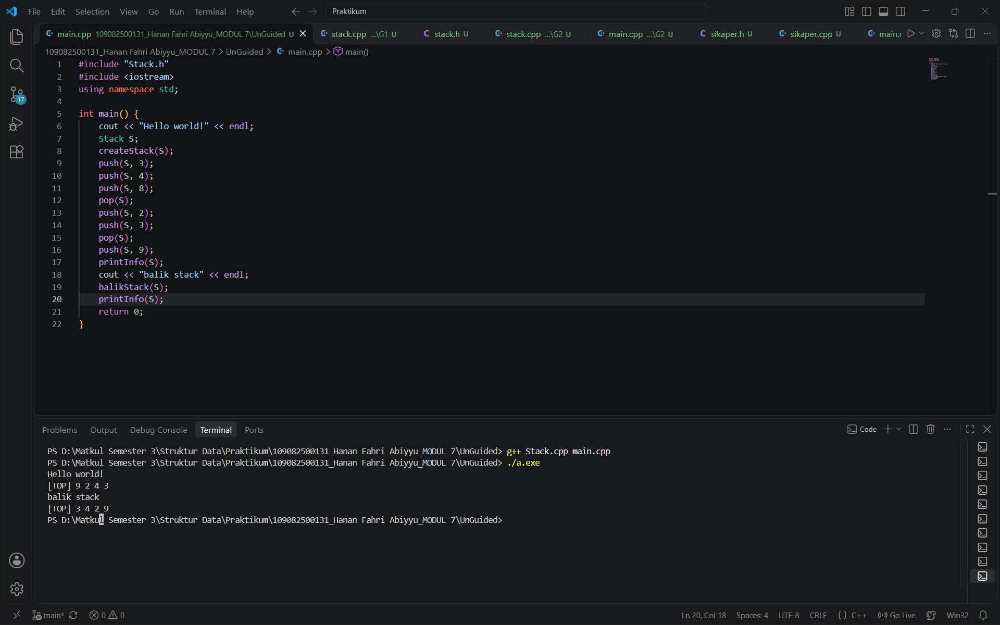
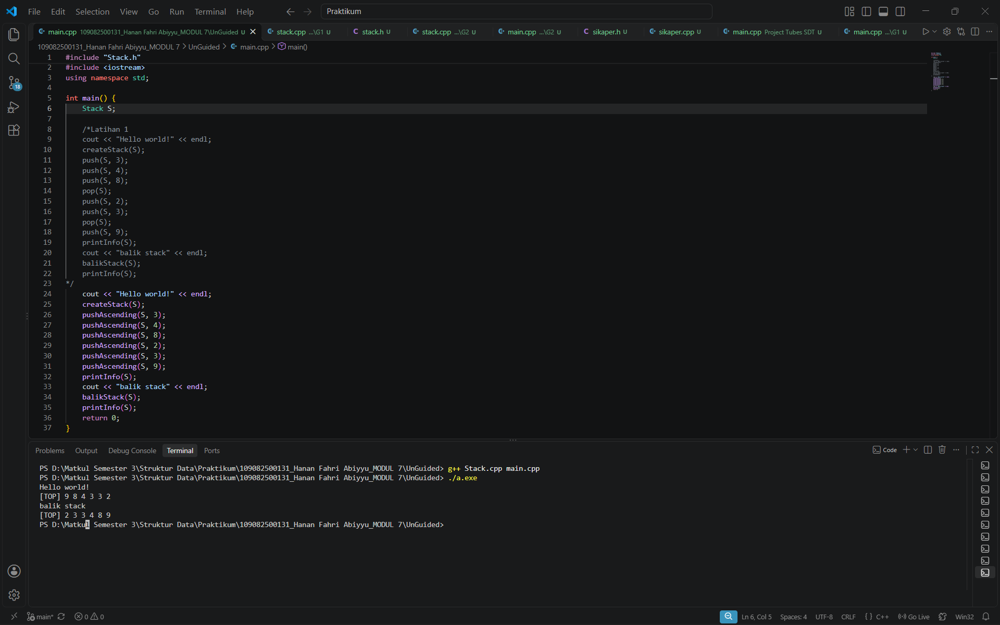
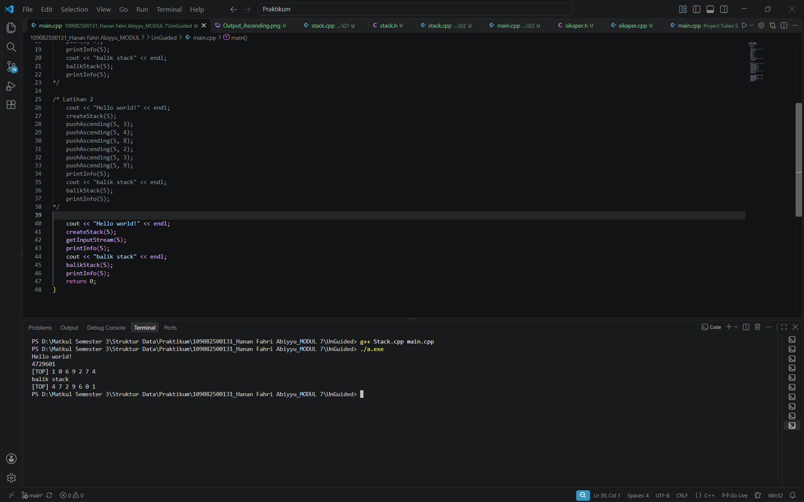

# <h1 align="center">Laporan Praktikum Modul 8 - QUEUE </h1>

<p align="center">Hanan Fahri Abiyyu - 109082500131</p>

## Dasar Teori

### A. Queue <br/>

Stack merupakan salah satu bentuk struktur data linier yang mengikuti aturan tertentu untuk melakukan operasi. Stack bersifat LIFO (Last In First Out) dan objek yang terakhir masuk ke dalam Stack akan menjadi yang pertama dikeluarkan [2].

#### Operasi Utama Stack
<br>
1. Push: menambahkan elemen baru ke dalam Stack pada posisi paling atas.
2. Pop: menghapus elemen teratas dari Stack dan mengembalikan nilainya.
3. Top: mengecek elemen teratas dari Stack tanpa menghapusnya.
4. IsEmpty: memeriksa apakah Stack kosong atau tidak.
5. Size: mengembalikan jumlah elemen dalam Stack. 

#### Kegunaan implementasi Stack 
Mengorganisasi data dan memudahkan penyimpanan komputer, digunakan dalam berbagai algoritma, seperti tower of hanoi, tree traversal, dan rekursi [2]. 

## Guided

### 1. Guided 

#### Queue.h (Linked list)
```C++
#ifndef QUEUE_H
#define QUEUE_H

#include <iostream>
#include <string>
using namespace std;


struct Node {
    string nama;
    Node *next;
};

struct queue {
    Node *head, *tail;
};

void createQueue(queue &Q);
bool isEmpty(queue Q);
bool isFull(queue Q);
void enQueue(queue &Q, const string &nama);
void deQueue(queue &Q);
void viewQueue(queue Q);
void clearQueue(queue &Q);

#endif
```

#### Queue.cpp (Linked List)
```C++
#include "Queue.h"

void createQueue(queue &Q) {
    Q.head = Q.tail = nullptr;
}

bool isEmpty(queue Q) {
    return Q.head == nullptr && Q.tail == nullptr; 
}

bool isFull(queue Q) {
    int maxQueue = 20;
    int count = 0;
    Node *nodeBantu = Q.head;

    while (nodeBantu != Q.tail) {
        count++;
        nodeBantu->next;
    }
    return count >= maxQueue;
}

void enQueue(queue &Q, const string &nama) {
    if (isEmpty(Q)) {
        Node *nodeBaru = new Node{nama, nullptr};
        Q.head = Q.tail = nodeBaru;
    }else{
        Node *nodeBaru = new Node{nama, nullptr};
        Q.tail->next = nodeBaru;
        Q.tail = nodeBaru;
    }
}

void deQueue(queue &Q) {
    if (isEmpty(Q)) {
        cout << "Queue kosong!";
    }else{
        Node *nodeHapus = Q.head;
        Q.head = Q.head->next;
        delete nodeHapus; 
    }
}

void viewQueue(queue Q) {
    if (isEmpty(Q)) {
        cout << "Queue kosong!";
    }else{
        Node *nodeBantu = Q.head;
        
        while (nodeBantu != nullptr) {
            cout << "Nama : " << nodeBantu->nama << endl; 
            nodeBantu = nodeBantu->next;
        }
    }
}

void clearQueue(queue &Q) {
    if (isEmpty(Q)) {
        cout << "Queue kosong!";
        
    }else{
        Node *nodeHapus = Q.head;
        while (nodeHapus != nullptr) {
            nodeHapus = nodeHapus->next;
            deQueue(Q);
        }
    }
}
```

#### main.cpp
```C++
#include "Queue.h"
#include <iostream>
using namespace std;

int main() {
    queue Q;
    createQueue(Q);
    enQueue(Q, "Gilar");
    enQueue(Q, "Aflah");
    enQueue(Q, "Aedil");
    enQueue(Q, "Fathir");
    enQueue(Q, "Kevin");
    enQueue(Q, "Zulfa");
    cout << endl;

    cout << "--- Isi Queue Setelah enQueue ---\n";
    viewQueue(Q);
    
    deQueue(Q);
    deQueue(Q);
    deQueue(Q);
    deQueue(Q);
    cout << endl;
    
    cout << "--- Isi Queue Setelah deQueue ---\n";
    viewQueue(Q);

    clearQueue(Q);    
    return 0;
}
```

Program di atas merupakan implementasi struktur data Queue menggunakan konsep Linked list yang berprinsip FIFO (First In First Out). Dalam implementasinya, program dibagi menjadi 3 file, meliputi queue.h (head), queue.cpp (logic), main.cpp (Execution). Struktur antreannya menggunakan node berisi data nama dan pointer penghubung yang diatur melalui penunjuk bagian depan serta belakang (head and tail), lengkap dengan pengecekan kondisi kosong maupun full.

Operasi utamanya mencakup inisialisasi antrean kosong, penambahan data di belakang, penghapusan data dari head, penampilan seluruh elemen, serta pembersihan antrean. Seluruh fitur tersebut dijalankan di main.cpp melalui skenario pengisian data nama, pemeriksaan isi antrean, penghapusan beberapa elemen, dan pengosongan antrean di akhir program.

### 2. Guided
#### Queue.h (Array)
```C++
#ifndef QUEUE_H
#define QUEUE_H

#include <iostream>
#include <string>
using namespace std;

const int MAX = 5;

struct queue {
    string nama[MAX];
    int head;
    int tail;
};

bool isEmpty(queue Q);
bool isFull(queue Q);
void createQueue(queue &Q);
void enQueue(queue &Q, string nama);
void deQueue(queue &Q);
void viewQueue(queue Q);

#endif
```


#### Queue.cpp (Array) 
```C++
#include "queue.h"
#include <iostream>

using namespace std;

// NOTE : 
// Implementasi 1 = head diam, tail bergerak (Queue Linear Statis, kerana head nya tetap diam)
// Implementasi 2 = head bergerak, tail bergerak (Queue Linear Dinamis, karena head & tail nya sama-sama bergerak)
// Implementasi 3 = head dan tail berputar (Queue Circular, karena jika udh mentok tapi masih ada space, diputar sehingga tail bisa ada didepan head)

bool isEmpty(queue Q){
    if(Q.head == -1 && Q.tail == -1){
        return true;
    } else {
        return false;
    }
}

//isFull implmenetasi 1 & 2
bool isFull(queue Q){
    if(Q.tail == MAX - 1){
        return true;
    } else {
        return false;
    }
}

// //isFull implementasi 3
// bool isFull(queue Q){
//     if((Q.tail + 1) % MAKSIMAL == Q.head){
//         return true;
//     } else {
//         return false;
//     }
// }

void createQueue(queue &Q){ //terbentuk queue dengan head = -1 dan tail = -1 
    Q.head = -1;
    Q.tail = -1;
}
 

//enqueue implementasi 1 & 2
void enQueue(queue &Q, string nama){
    if(isFull(Q) == true){
        cout << "Queue sudah penuh!" << endl;
    } else {
        if(isEmpty(Q) == true){
            Q.head = Q.tail = 0;
        } else {
            Q.tail++;
        }
        Q.nama[Q.tail] = nama;
        cout << "nama " << nama << " berhasil ditambahkan kedalam queue!" << endl;
    }
}

// //enQueue implementasi 3
// void enQueue(queue &Q, string nama){
//     if(isFull(Q) == true){
//         cout << "Queue sudah penuh!" << endl;
//     } else {
//         if(isEmpty(Q) == true){
//             Q.head = Q.tail = 0;
//         } else {
//             Q.tail = (Q.tail + 1) % MAKSIMAL; // bergerak melingkar
//         }
//         Q.nama[Q.tail] = nama;
//         cout << "nama " << nama << " berhasil ditambahkan kedalam queue!" << endl;
//     }
// }

//dequeue implementasi 1
void deQueue(queue &Q){
    if(isEmpty(Q) == true){
        cout << "Queue kosong!" << endl;
    } else {
        cout << "Mengahapus data " << Q.nama[Q.head] << "..." << endl;
        for(int i = 0; i < Q.tail; i++){
            Q.nama[i] =  Q.nama[i+1];
        }
        Q.tail--;
        if(Q.tail < 0){ //kalo semua isi queue nya udh dikeluarin, set head & tail ke -1
            Q.head = -1;
            Q.tail = -1;
        }
    }
}

// //dequeue implementasi 2
// void deQueue(queue &Q){
//     if(isEmpty(Q) == true){
//         cout << "Queue kosong!" << endl;
//     } else {
//         cout << "Mengahapus data " << Q.nama[Q.head] << "..." << endl;
//         Q.head++;
//         if(Q.head > Q.tail){ //kalo elemennya udh abis (head akan lebih 1 dari tail), maka reset ulang head & tail ke -1
//             Q.head = -1;
//             Q.tail = -1;
//         }
//     }
// }

// //deQueue implementasi 3
// void deQueue(queue &Q){
//     if(isEmpty(Q) == true){
//         cout << "Queue kosong!" << endl;
//     } else {
//         cout << "Mengahapus data " << Q.nama[Q.head] << "..." << endl;
//         if(Q.head == Q.tail){ //kalo elemennya tinggal 1, langsungkan saja head & tail nya reset ke -1
//             Q.head = -1;
//             Q.tail = -1;
//         } else {
//             Q.head = (Q.head + 1) % MAKSIMAL; // bergerak melingkar
//         }
//     }
// }

//viewQueue implementasi 1 & 2
void viewQueue(queue Q){
    if(isEmpty(Q) == true){
        cout << "Queue kosong!" << endl;
    } else {
        for(int i = Q.head; i <= Q.tail; i++){
            cout << i -  Q.head + 1 << ". " << Q.nama[i] << endl;
        }
    }
    cout << endl;
}

// //viewQueue implementasi 3
// void viewQueue(queue Q){
//     if(isEmpty(Q) == true){
//         cout << "Queue kosong!" << endl;
//     } else {
//         int i = Q.head;
//         int count = 1;
//         while(true){
//             cout << count << ". " << Q.nama[i] << endl;
//             if(i == Q.tail){
//                 break;
//             }
//             i = (i + 1) % MAKSIMAL;
//             count++;
//         }   
//     }
// }
```
#### main.cpp 
```C++
#include "queue.h"
#include <iostream>

using namespace std;

int main(){
    queue Q;

    createQueue(Q);
    enQueue(Q, "Dimas");
    enQueue(Q, "Arvin");
    enQueue(Q, "Rizal");
    enQueue(Q, "Hafizh");
    enQueue(Q, "Fathur");
    enQueue(Q, "Daffa");
    cout << endl;

    cout << "--- Isi Queue Setelah enQueue ---" << endl;
    viewQueue(Q);
    cout << endl;

    deQueue(Q);
    deQueue(Q);
    deQueue(Q);
    deQueue(Q);
    // deQueue(Q);
    // deQueue(Q);
    cout << endl;

    cout << "--- Isi Queue Setelah deQueue ---" << endl;
    viewQueue(Q);

    return 0;
}
```
Program ini masih pada materi dan implementasi yang mirip dengan program sebelumnya, yaitu Queue dengan menerapkan prinsip yang sama, FIFO (First In First Out). Perbedaannya ada pada struktur kodenya. Pada program sebelumnya, implementasi Queue menggunakan Linked list, sementara pada program ini implementasinya menggunakan Array.

Pada file header, antrean diatur menggunakan array berukuran tetap dengan head dan tail sebagai penanda posisi indeks, lengkap dengan fungsi pengecekan kondisi kosong atau penuh serta prosedur inisialisasi awal. Operasi penambahan data dilakukan lewat enQueue ke bagian belakang antrean selama kapasitas belum penuh, sedangkan deQueue mengambil data paling depan lalu menyesuaikan posisi indeks atau menggeser elemen sesuai mekanisme yang dipakai (linear maupun berputar), serta mereset penanda saat antrean habis. Selain itu, viewQueue bertugas menampilkan daftar isi antrean yang sedang aktif, dan seluruh alurnya diuji di file main mulai dari memasukkan data, melihat isi antrean, hingga menghapus beberapa data dan mengecek sisanya.

## Unguided

### 1. Latihan 

#### queue.h

```C++
#ifndef QUEUE_H
#define QUEUE_H

#include <iostream>
using namespace std;
const int MAX = 5;

typedef int infotype;
struct Queue {
    infotype info[MAX];
    int head, tail;
};

void createQueue(Queue &Q);
bool isEmptyQueue(Queue Q);
bool isFullQueue(Queue Q);
void enqueue(Queue &Q, infotype x);
infotype dequeue(Queue &Q);
void printInfo(Queue Q);

#endif
```

#### queue.cpp
```C++
#include "queue.h"

void createQueue(Queue &Q) {
    Q.head = -1; 
    Q.tail = -1;
}

bool isEmptyQueue(Queue Q) {
    if (Q.head == -1 && Q.tail == -1){
        return true;
    }else{
        return false;
    }
}


// Full queue

/* Full Alter 1
bool isFullQueue(Queue Q) {
    if (Q.tail == MAX - 1) {
        return true;
    }else{
        return false;
    }
}
*/

/* Full ALter 2
bool isFullQueue(Queue Q) {
    return (Q.head == 0 && Q.tail == MAX - 1);
}
*/


// Full Alter 3
bool isFullQueue(Queue Q) {
    return ((Q.tail + 1) % MAX == Q.head);
}


// enqueue

/* enqueue Alter 1 
void enqueue(Queue &Q, infotype x) {

    if(isFullQueue(Q) == true) {
        cout << "queue is full!\n";
    }else{
        if (isEmptyQueue(Q) == true) {
            Q.head = 0;
            Q.tail = 0;
        }else{
            Q.tail++;
        }
        Q.info[Q.tail] = x;
    }

}
*/

/* enqueue Alter 2
void enqueue(Queue &Q, infotype x) {
    if (isEmptyQueue(Q)) {
        Q.head = 0;
        Q.tail = 0;
        Q.info[Q.tail] = x;
    }else if (Q.tail == MAX - 1) {
        if (Q.head == 0) {
            cout << "queue is full!\n";
        }else{
            int j = 0;
            for (int i = Q.head; i <= Q.tail; i++) {
                Q.info[j] = Q.info[i];
                j++;
            }
            Q.tail -= Q.head;
            Q.head = 0;
            Q.tail++;
            Q.info[Q.tail] = x;
        }
    }else{
        Q.tail++;
        Q.info[Q.tail] = x;
    }
}
*/

// enqueue Alter 3
void enqueue(Queue &Q, infotype x) {
    if (isFullQueue(Q)) {
        cout << "queue is full!\n";
    }else{
        if (isEmptyQueue(Q)) {
            Q.head = 0;
            Q.tail = 0;
        }else{
            Q.tail = (Q.tail + 1) % MAX;
        }
        Q.info[Q.tail] = x;
    }
}


// deqeueue 

/* dequeue ALter 1 
infotype dequeue(Queue &Q) {
    if(isEmptyQueue(Q) == true) {
        cout << "empty queue\n";
        return -1;
    }
    infotype val = Q.info[Q.head];

    if (Q.head == Q.tail) {
        Q.head = -1; 
        Q.tail = -1;
    }else{
        for (int i = Q.head; i < Q.tail; i++) {
            Q.info[i] = Q.info[i+1];
        }
        Q.tail--;
    }    
    return val;
}
*/

/* dequeue Alter 2
infotype dequeue(Queue &Q) {
    if(isEmptyQueue(Q) == true) {
        cout << "empty queue\n";
        return -1;
    }
    infotype val = Q.info[Q.head];

    if (Q.head == Q.tail) {
        Q.head = -1; 
        Q.tail = -1;
    }else{
        Q.head++;
    }
    return val;
}
*/

// dequeue Alter 3
infotype dequeue(Queue &Q) {
    if (isEmptyQueue(Q)) {
        cout << "empty queue\n";
        return -1;
    }
    infotype val = Q.info[Q.head];
    if (Q.head == Q.tail) {
        Q.head = -1;
        Q.tail = -1;
    }else{
        Q.head = (Q.head + 1) % MAX;
    }

    return val;
}


// printQueue

/* printInfo ALter 1 & 2 
void printInfo(Queue Q) {
    
    if (isEmptyQueue(Q) == true) {
        cout << "-1 - -1  | empty queue\n";
    }else{
        cout << Q.head << " - " << Q.tail << "    | ";
        for (int i = Q.head; i <= Q.tail; i++) {
            cout << Q.info[i];
            if (i < Q.tail) {
                cout << " ";
            }
        }
        cout << endl;
    }

}
*/

// printInfo ALter 3
void printInfo(Queue Q) {
    
    if (isEmptyQueue(Q) == true) {
        cout << "-1 - -1  | empty queue\n";
    }else{
        cout << Q.head << " - " << Q.tail << "    | ";
        int i = Q.head;
        while (true) {
            cout << Q.info[i];
            if (i == Q.tail) {
                break;;
            }
            cout << " ";
            i = (i + 1) % MAX;
        }
        cout << endl;    
    }
}
```

#### main.cpp
```C++
#include "queue.h"
#include <iostream>
using namespace std;

int main() {
    cout << "Hello World" << endl;
    Queue Q;
    createQueue(Q);

    /* Alter 1
    cout << "Alternatif 1" << endl;
    cout << "----------------------" << endl;
    cout << " H - T \t | Queue info" << endl;
    cout << "----------------------" << endl;
    printInfo(Q);
    enqueue(Q, 5); printInfo(Q);
    enqueue(Q, 2); printInfo(Q);
    enqueue(Q, 7); printInfo(Q);
    dequeue(Q); printInfo(Q);
    enqueue(Q, 4); printInfo(Q);
    dequeue(Q); printInfo(Q);
    dequeue(Q); printInfo(Q);
    dequeue(Q); printInfo(Q);
    */

    /* Alter 2
    cout << "Alternatif 2" << endl;
    cout << "----------------------" << endl;
    cout << " H - T \t | Queue info" << endl;
    cout << "----------------------" << endl;
    printInfo(Q);
    enqueue(Q, 5); printInfo(Q);
    enqueue(Q, 2); printInfo(Q);
    enqueue(Q, 7); printInfo(Q);
    dequeue(Q); printInfo(Q);
    enqueue(Q, 4); printInfo(Q);
    dequeue(Q); printInfo(Q);
    dequeue(Q); printInfo(Q);
    dequeue(Q); printInfo(Q);
    */


    // Alter 3
    cout << "Alternatif 3" << endl;
    cout << "----------------------" << endl;
    cout << " H - T \t | Queue info" << endl;
    cout << "----------------------" << endl;
    printInfo(Q);
    enqueue(Q, 5); printInfo(Q);
    enqueue(Q, 2); printInfo(Q);
    enqueue(Q, 7); printInfo(Q);
    dequeue(Q); printInfo(Q);
    enqueue(Q, 4); printInfo(Q);
    dequeue(Q); printInfo(Q);
    dequeue(Q); printInfo(Q);
    dequeue(Q); printInfo(Q);

    return 0;
}
```
### Output Unguided 1 :

##### Output 1 Balik Stack



##### Output 2 Ascending



##### Output 3 Get Input 



Penjelasan unguided 1 :
Pada soal ini, terdapat tiga perintah atau latihan pada implementasi Stack.

<br>
1. Balik Stack 
Fokus utama pada bagian ini adalah membalik urutan elemen di dalam array secara fisik. Karena sifat dasar stack itu kaku dengan prinsip LIFO (data yang terakhir masuk selalu berada di puncak), prosedur ini dibuat untuk membalik posisi seluruh tumpukan—sehingga data yang tadinya berada di dasar berpindah ke puncak, dan sebaliknya. Hal ini biasanya diperlukan ketika kita ingin membaca atau memproses urutan data dari sudut pandang yang berkebalikan dengan struktur aslinya.
<br>
2. Penyisipan Nilai Berdasarkan Ascending
Prosedur pushAscending dirancang agar data yang masuk langsung tersusun secara menaik (ascending) dari bawah ke atas. Logikanya berjalan dengan cara mencari posisi yang tepat untuk angka baru, menggeser elemen-elemen di atasnya untuk menyediakan ruang, lalu menyisipkan data tersebut ke posisi yang sesuai. Dengan begitu, tumpukan akan selalu berada dalam kondisi terurut rapi setiap kali ada data baru yang dimasukkan.
<br>
3. Pembacaan Input Nilai Secara Dinamis
Bagian ini berfokus pada bagaimana program menerima dan mengolah data masukan dari pengguna secara langsung lewat stream karakter. Program memanfaatkan fungsi cin.get() untuk membaca deretan karakter yang diketikkan pengguna secara terus-menerus sampai tombol Enter ditekan.

## Kesimpulan
Melalui praktikum Modul 7 mengenai struktur data Stack (tumpukan), saya memahami bagaimana cara kerja penyimpanan data berbasis prinsip LIFO (Last In, First Out). Pada materi ini, pengimplementasiannya dapat dilakukan dengan dua cara, yakni menggunakan array memakai variabel top ataupun linked list dengan konsep insert first, serta dilengkapi berbagai fungsi tambahan seperti pembaruan data dan penyisipan terurut.

## Referensi

<br>
[1] Fakultas Informatika, Telkom University, “Modul 8: Queue,” dalam Modul Praktikum Struktur Data, Bandung, Indonesia: Telkom University, 2026, hlm. 59–65.
<br>
[2] A. Trijayanti, I. Aulia, N. Khairunisa, F. A. H. Purba, and I. Gunawan, "Implementasi Struktur Data Antrian Queue dalam Sistem Penjadwalan Proses pada Sistem Operasi," Jurnal Publikasi Teknik Informatika, vol. 4, no. 2, pp. 48–53, May 2025.